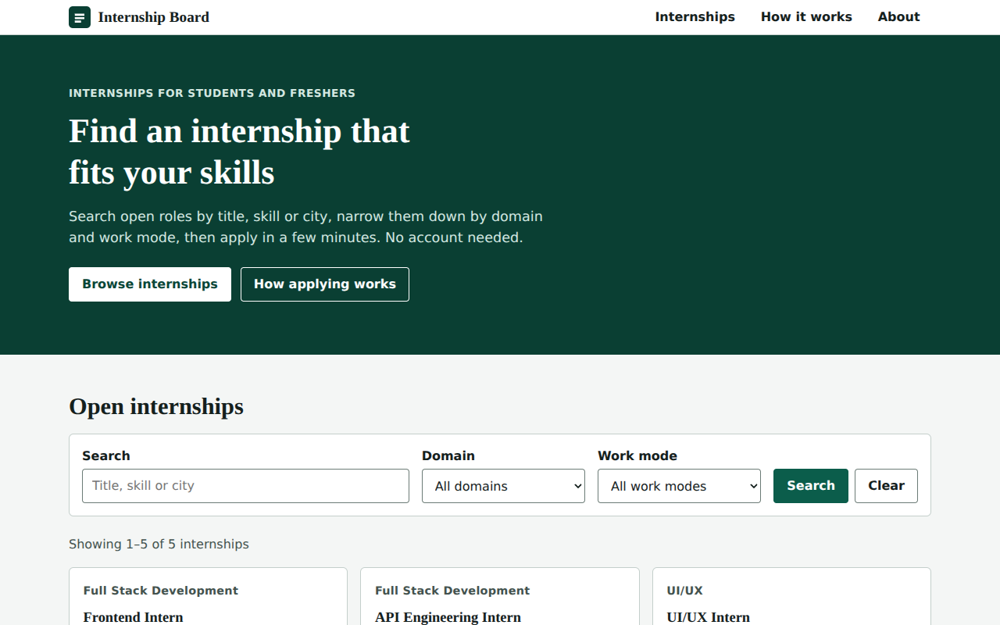
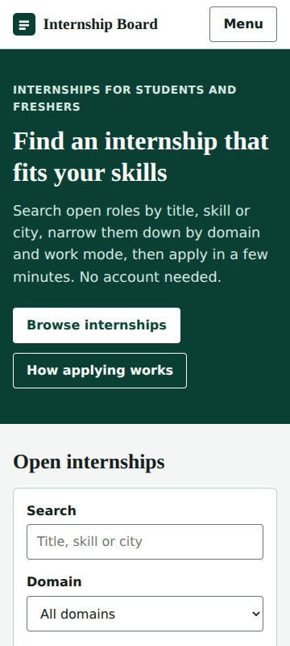

# Internship Board

A full-stack internship portal: browse internships, search and filter them, and apply through a secure form. Built for **EdVyro Full Stack Development**, Tasks 1 to 4, in one project.



## 1. Project overview

Visitors see a landing page with internship cards loaded from a REST API. They can search by title, domain, location or skill, filter by domain and work mode, open a details dialog and submit an application (name, email, resume link, optional cover letter). Applications are saved in SQLite and the same person cannot apply to the same internship twice.

| Task | What it added |
|------|---------------|
| 1 | Responsive frontend with search and filters |
| 2 | REST API, SQLite storage, pagination, validation |
| 3 | Secure application form, duplicate prevention, security middleware, tests |
| 4 | Polished landing page and mobile menu, logging and health checks, performance work, accessibility / security / performance / test reports, deployment notes |

## 2. Main features

- Landing page with responsive navigation (menu button on phones)
- Internship cards loaded from the API, with work-mode labels, skills and openings
- Search (title, domain, location, skills) that updates after you stop typing, plus domain and work-mode filters
- Pagination, and a page address that keeps your search so it can be shared or reloaded
- Accessible details dialog (Esc closes it, focus returns to the button)
- Application form with clear field-by-field messages, a duplicate-application message, and a confirmation with a reference number
- Loading placeholders, empty state, friendly error state with a working **Try again** button
- Server-side validation, rate limiting, secure headers, safe errors
- Request logging with response times and a database-aware health check
- 215 automated tests, plus a repeatable real-browser audit (`audit/`)



## 3. Technology stack

| Part | Technology |
|------|------------|
| Server | Node.js 22.13 or newer, Express 5 |
| Database | SQLite through Node's built-in `node:sqlite` (nothing to compile) |
| Front end | HTML, CSS and plain JavaScript (no framework) |
| Security | Helmet, express-rate-limit, cors |
| Performance | compression |
| Tests | Node's built-in test runner, jsdom (development only) |
| Audit tools (separate folder, not app dependencies) | puppeteer-core, Lighthouse, axe-core |

## 4. Architecture

```
Browser (public/index.html, app.js, styles.css)
   |  fetch /api/...  (JSON)
   v
Express app (src/app.js)
   1. request logger  (adds X-Request-Id, logs method / route / status / ms)
   2. Helmet headers + Permissions-Policy
   3. compression
   4. GET /api/health            <- before the rate limiter on purpose
   5. CORS policy -> API rate limit -> cache headers -> JSON-only check -> JSON body (10 KB max)
   6. routes -> validation middleware -> controllers
   7. static files (public/)
   8. central error handler -> safe JSON, never a stack trace
   v
SQLite (src/db.js): prepared statements with ? parameters only
```

`POST /api/applications` also passes a stricter rate limiter. The page and the API are served by the same Express server, so no CORS setup is needed by default.

## 5. Folder structure

```
audit/        real-browser audit tool (Lighthouse, axe, layout, keyboard). Own package.json
database/     schema.sql, seed.sql  (the .db file is created on first start, not committed)
docs/         api-examples, test / accessibility / security / performance reports, walkthrough
docs/evidence/  raw audit data and screenshots used by the reports
public/       index.html, app.js, styles.css, favicon.svg
src/
  app.js, server.js, config.js, db.js
  controllers/  internshipController.js, applicationController.js
  middleware/   errorHandler.js, requestLogger.js, security.js, validation.js
  routes/       internships.js, applications.js
  utils/        logger.js, response.js
tests/        api, persistence, applications, security, observability, frontend, design (+ helpers.js)
.env.example  settings with placeholders only
render.yaml   optional Render Blueprint (Free plan)
```

## 6. Installation (Windows PowerShell)

Install Node.js 22.13 or newer from nodejs.org, then:

```powershell
node -v                      # should print v22.13.0 or higher
cd path\to\internship-board
npm install
Copy-Item .env.example .env  # optional: the defaults also work
npm start
```

Open http://localhost:3000. Stop the server with `Ctrl + C`.

## 7. Environment variables

All are optional. Real values go in `.env` (never committed) or in Render's Environment tab.

| Variable | Default | Purpose |
|----------|---------|---------|
| `PORT` | `3000` | Port to listen on |
| `NODE_ENV` | unset | `production` makes logs JSON, caches static files for 5 minutes and adds `upgrade-insecure-requests` to the CSP |
| `DATABASE_PATH` | `./database/internship-board.db` | SQLite file |
| `RATE_LIMIT_WINDOW_MS` | `900000` (15 min) | Rate-limit window |
| `RATE_LIMIT_API_MAX` | `300` | Requests per window per IP |
| `RATE_LIMIT_APPLICATION_MAX` | `10` | Application submissions per window per IP |
| `LOG_LEVEL` | `info` (`silent` in tests) | `debug`, `info`, `warn`, `error`, `silent` |
| `LOG_FORMAT` | `json` in production, else `text` | `json` or `text` |
| `STATIC_MAX_AGE_SECONDS` | `300` in production, else `0` | Browser cache time for CSS / JS |
| `CORS_ORIGIN` | empty | Exact origins allowed to call the API from another site. Empty = none |
| `PUBLIC_API_BASE_URL` | empty | API origin the browser should call. Empty = same server |
| `TRUST_PROXY` | `0` | Number of proxies in front of the app. **Use `1` on Render** |

## 8. Database setup

The schema is applied automatically at every start (`CREATE TABLE IF NOT EXISTS`). To run it by hand: `npm run db:init`.

Tables: `internships` and `applications`. `applications` has `UNIQUE (internship_id, applicant_email)` (email compared without regard to letter case), a foreign key to `internships`, and length checks on `resume_url` (2048) and `cover_letter` (2000).

Upgrading an older Task 2 database file is safe: missing columns are added on start, existing rows are kept, and repeating it does nothing (covered by a test).

## 9. Seed commands

```powershell
npm run db:seed
```

Seeds INT-101 to INT-105 with `INSERT OR IGNORE`: safe to repeat, never overwrites. A brand-new database file is seeded automatically on first start.

## 10. API endpoints

| Method | Path | Description |
|--------|------|-------------|
| GET | `/api/health` | App and database health |
| GET | `/api/internships?search=&domain=&mode=&page=&limit=` | List with pagination |
| GET | `/api/internships/:id` | One internship (404 if unknown) |
| GET | `/api/domains` | Distinct domain names for the filter |
| POST | `/api/applications` | Submit an application |
| POST / PUT / DELETE | `/api/internships`, `/api/internships/:id` | Task 2 create / update / delete (**no login, see Known limitations**) |

Success: `{ "status": "success", "data": ..., "pagination": ... }` (pagination only on lists). Error: `{ "status": "error", "error": { "code", "message", "fields"? } }`.

Application rules: `internship_id` must exist; `applicant_name` 2 to 100 characters; `applicant_email` valid and at most 254 characters; `resume_url` is required and must be `http` or `https`; `cover_letter` is optional, up to 2000 characters. Status codes: 201 created, 400 invalid, 404 unknown internship, 409 duplicate, 415 not JSON, 429 too many requests, 500 generic error.

Examples and the full table: `docs/api-examples.md`.

## 11. Security measures

Helmet headers and a strict Content Security Policy (no inline code, no wildcards), CORS closed by default, API and application rate limits (429), 10 KB body limit and JSON-only bodies, server-side validation with unknown fields ignored, `http(s)`-only resume links, parameterised SQL, a database UNIQUE rule against duplicates, generic 500 errors, no personal data in logs, `.env` git-ignored. Output is written with `textContent`, never `innerHTML`.

Full table, evidence and limitations: [`docs/security-report.md`](docs/security-report.md).

## 12. Logging and health checks

Each request produces one log line with method, route, status code, response time and a request ID (also returned in the `X-Request-Id` header). Example (text format):

```
2026-10-20T10:15:02.123Z INFO  request requestId=9f1c... method=GET path=/api/internships/INT-101 route=/api/internships/:id status=200 ms=1.84
```

Never logged: names, emails, resume links, cover letters, request bodies, query strings, IP addresses. Errors are logged with a short safe summary; clients only see a generic message. Health pings are logged only at `debug` level.

`GET /api/health` returns `{"status":"success","data":{"message":"Internship API is running","database":"ok","uptime_seconds":N,"version":"..."}}`, or a generic `503` if the database cannot be reached. It is not counted by the rate limiter.

## 13. Testing

```powershell
npm test
```

**Last actual result** (Node.js v22.22.2, Linux sandbox): **215 tests, 215 passed, 0 failed**, about 9 seconds. Not run on Windows or Node 24 by me: please run it on your computer and add your result in `docs/test-report.md`. `npm audit`: 0 vulnerabilities.

Tests use temporary databases and never touch your real data. Details: [`docs/test-report.md`](docs/test-report.md).

## 14. Accessibility verification

- **Automated in `npm test`:** landmarks, labels, ARIA references, heading order, live regions, focus behaviour, menu and dialog behaviour, and colour contrast calculated from the real colours (32 pairs, all pass).
- **Real browser (headless Chromium 153):** axe-core found 0 violations in 6 page states (colour contrast inside the dialog is marked "needs review", which is not a pass), keyboard flow works, no sideways scrolling at 320 to 1280 px, no control under 44 px.
- **Not done:** screen-reader testing, real phones, zoom 200% / 400%, forced-colours mode. Listed as an open checklist in the report.

Full report: [`docs/accessibility-report.md`](docs/accessibility-report.md).

## 15. Performance report

Measured on localhost with headless Chromium and Lighthouse 13.5.0 (6 runs per build, order Task 4 / Task 3 / Task 3 / Task 4). The machine was noisy, so medians and every raw run are in the report.

| Metric | Task 3 | Task 4 |
|--------|--------|--------|
| Lighthouse performance, mobile / desktop (median) | 96.5 / 97.5 | 100 / 99 |
| Layout shift (CLS), mobile / desktop (median) | 0.075 / 0.045 | 0 / 0 |
| First-visit download | 38,299 bytes | 19,932 bytes |

Accessibility, best-practices and SEO scored 100 in all 24 runs. These numbers are **not** from the live Render site (which also needs a cold-start wait on the free plan). Fill in your live result in the report. Full detail: [`docs/performance-report.md`](docs/performance-report.md).

## 16. Deployment (Render Free plan)

1. Push the project to GitHub (do not commit `.env` or any `.db` file).
2. In Render: **New > Web Service**, choose the repository. Runtime: Node. Build command: `npm ci --omit=dev`. Start command: `npm start`. Plan: **Free**.
3. Environment: `NODE_ENV=production`, `TRUST_PROXY=1`, and `NODE_VERSION=22`. Leave `CORS_ORIGIN` and `PUBLIC_API_BASE_URL` empty. Health check path: `/api/health`.
4. After it deploys, open `/api/health` and submit a test application.

`render.yaml` contains the same settings as an optional Blueprint. I have not been able to test it against your Render account.

> **Data persistence warning.** Render Free has **no persistent disk**. The SQLite file lives on temporary storage, so **data is not guaranteed to survive a restart, a redeploy or the service sleeping after idle time**. After any of these the database is recreated and re-seeded with INT-101 to INT-105, and submitted applications are lost. This deployment is for demonstration only: do not collect real applicant data on it. Permanent storage would need a paid disk or an external database, which this project does not use.

## 17. Live website URL

The deployment recorded in the previous version of this README: https://edvyro-task-2-internship-board.onrender.com

**Before submitting:** push Task 4, wait for Render to redeploy, open `/api/health` and confirm `"database":"ok"` and a `version` field (this proves the new code is live), and replace or confirm the URL here. I have not deployed anything or checked this site.

## 18. GitHub repository URL

`PASTE YOUR PUBLIC REPOSITORY LINK HERE` (for example `https://github.com/<your-username>/<your-repository>`)

## 19. Walkthrough video

`PASTE YOUR VIDEO LINK HERE AFTER YOU UPLOAD IT`. Recording script: [`docs/walkthrough.md`](docs/walkthrough.md).

## 20. Known limitations

- **Render Free resets the database** (section 16). Nothing is permanently stored there.
- **No authentication.** Anyone who knows the API can create, edit or delete internships through the Task 2 endpoints. Fix before real use (for example an admin key or login).
- Rate-limit counters live in memory and reset on restart; they are per server instance.
- No CAPTCHA and no email verification; resume links are stored but not checked.
- Search scans every row, which is fine for small data but would need an index or full-text search at large scale.
- Static files are not fingerprinted, so they are cached for only 5 minutes.
- Lighthouse and audit numbers come from a noisy shared sandbox on localhost, not from the live site.
- Screen readers, real phones and zoom levels have not been tested.

## Reports and evidence

| File | Contents |
|------|----------|
| [`docs/test-report.md`](docs/test-report.md) | Automated tests and real-browser checks |
| [`docs/accessibility-report.md`](docs/accessibility-report.md) | Accessibility results and manual checklist |
| [`docs/security-report.md`](docs/security-report.md) | Controls, evidence, residual risks |
| [`docs/performance-report.md`](docs/performance-report.md) | Measured performance and method |
| [`docs/walkthrough.md`](docs/walkthrough.md) | Two-minute video script |
| `docs/evidence/` | Raw audit output and screenshots |

To repeat the real-browser audit: run `npm start` in one window, then in another: `cd audit; npm install; $env:CHROME_PATH = "C:\Program Files\Google\Chrome\Application\chrome.exe"; node run.mjs`.
